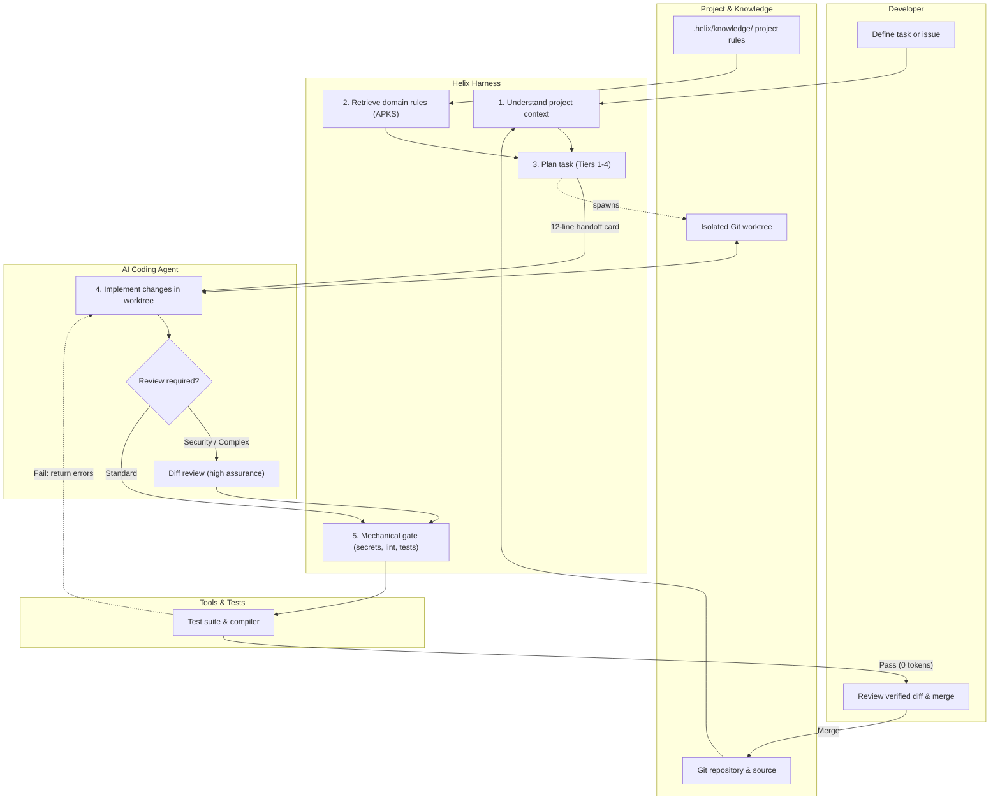

# Helix

**Helix is an open-source harness for AI coding agents that cuts token waste, isolates execution in ephemeral Git worktrees, and guarantees code quality with zero-token mechanical gates.**

[Installation](docs/INSTALL.md) · [Documentation](docs/index.md) · [Quick Start](docs/QUICKSTART.md) · [Benchmarks](benchmarks/README.md) · [Contributing](CONTRIBUTING.md)

---

## How Helix Works

Helix sits between the developer, the underlying AI coding agent (Claude Code, Cursor, OpenCode, Codex), and the project repository to keep coding workflows disciplined, isolated, and verified:



For detailed architecture and workflow lifecycle diagrams, see [Development Workflow](docs/diagrams/development-workflow.md) and [System Architecture](docs/diagrams/architecture.md).

---

## Does Helix Actually Help? The Evidence

We do not ask developers to trust architectural claims. We evaluate Helix head-to-head against unharnessed baseline agents on identical models, tasks, and commits using paired bootstrap statistics (10,000 resamples):

| Measurement                 | Unharnessed Agent | With Helix (`helix-min`) |                   Measured Difference | Statistical Verdict        |
| --------------------------- | ----------------: | -----------------------: | ------------------------------------: | -------------------------- |
| **Task Completion**         |      16/16 (100%) |             16/16 (100%) |                    0 discordant pairs | **Parity maintained**      |
| **Median Uncached Tokens**  |     22,268 tokens |            19,437 tokens |  **-12.7%** (95% CI: -23.9% .. -0.3%) | **saves tokens**           |
| **Deep Call Chain Tracing** |     24,638 tokens |            18,521 tokens |  **-24.8%** (95% CI: -37.3% .. -9.0%) | **saves tokens**           |
| **Zero-Token Verification** |          0 checks |          100% mechanical | **0 model tokens** (15-30s wall time) | **Eliminates regressions** |
| **Graphify MCP Overhead**   |          Baseline |        With Graphify MCP | **+28.7%** (95% CI: +13.8% .. +45.5%) | **costs tokens**           |

### What the Evidence Teaches Us:

1. **Instructions & Gates Save Tokens:** `helix-min` achieves statistically significant token savings (-12.7% overall, -24.8% on deep call chains) by providing exact test commands in `AGENTS.md` and preventing exploratory wheel-spinning.
2. **Subagents Do Not Help Routine Tasks:** Single-agent execution is token-optimal for standard bug fixes. Multi-agent swarms add +61% to +140% token overhead without increasing pass rates.
3. **Graph Intelligence Has a Size Floor:** Graphify MCP adds +28.7% tokens on moderate codebases (~52 files) due to schema and search overhead. Helix defaults to lightweight maps on normal repos.

For complete data and methodology, see [Benchmark Methodology](docs/benchmarks/methodology.md), [Results & Findings](docs/benchmarks/results.md), and [Limitations & Trade-offs](docs/benchmarks/limitations.md).

---

## Why Helix?

Most AI agent frameworks assume that adding more agents produces better code. In practice, uncoordinated multi-agent swarms multiply token consumption by 3x–4x and increase regression rates through conversational drift.

Helix enforces a disciplined, evidence-based engineering philosophy:

- **Single-Agent by Default**: Routine tasks run in a single session at minimum token cost (~815 tokens/task).
- **Mechanical Validation Over Claims**: An agent claiming "all tests pass" is ignored; success is determined solely by zero-token verification gates (`.helix/gate.mjs`).
- **Worktree Isolation**: Ephemeral Git worktrees prevent workspace corruption and dirty working trees.
- **Independent Adversarial Review**: For complex or sensitive tasks, an isolated reviewer inspects only the diff and requirements, eliminating regressions at a modest +61% token premium.

---

## What Helix Improves for Developers

| Technical Capability                                 | Everyday Developer Benefit                                                                        |
| ---------------------------------------------------- | ------------------------------------------------------------------------------------------------- |
| **Targeted Pack Generation (`helix init`)**          | Sets up platform configs and `AGENTS.md` (≤300t) without wading through vendor docs.              |
| **Zero-Token Verification Gate (`helix gate`)**      | Catches syntax errors, lint failures, and broken tests before code is considered done.            |
| **Worktree Sandboxing (`helix run`)**                | Executes changes in ephemeral worktrees; aborted or failed tasks never corrupt your working tree. |
| **Adaptive Project Knowledge (`.helix/knowledge/`)** | Remembers domain boundaries and naming rules without having to re-explain them.                   |
| **Repeatable Benchmark Suite (`helix bench`)**       | Allows teams to independently measure whether agent configurations actually save tokens.          |

---

## Features

- **Harness Pack Generation**: Emits deterministic, minimal instruction packs (`AGENTS.md` ≤ 300 tokens) tailored per platform.
- **Autonomous Task Execution (`helix run`)**: Drives coding tasks with progressive context assembly, worktree isolation, and bounded retries.
- **Zero-Token Verification Gate (`helix gate`)**: Mechanically scans secrets, checks linting, runs typecheck, and executes affected tests.
- **Repeatable Benchmark Suite (`helix bench`)**: Evaluates pass rates, regression tracking, and costs across 10 task categories and 5 execution strategies.
- **Security & Least-Privilege Sandboxing**: Path jail confinement, secret redaction, untrusted content framing, and role-based permissions.
- **Observability & Diagnostics**: Real-time event streaming, structured `--json` reports, token counting via `gpt-tokenizer`, and `helix doctor`.

---

## Installation

Install Helix without cloning its source repository:

### Global npm (Recommended)

```sh
npm install -g @sm-me-dev/helix
```

Or execute directly with zero install:

```sh
npx @sm-me-dev/helix --help
```

### Universal Standalone Installer (Linux & macOS)

Downloads a self-contained application bundle with an embedded Node runtime (no system Node installation required):

```sh
curl -fsSL https://sm-me-dev.github.io/helix/install.sh | sh
```

### Homebrew (macOS & Linux)

```sh
brew install sm-me-dev/tap/helix
```

### Debian / Ubuntu (APT)

```sh
curl -fsSL https://sm-me-dev.github.io/helix/install-apt.sh | sudo sh
```

### Windows (PowerShell)

```powershell
irm https://sm-me-dev.github.io/helix/install.ps1 | iex
```

### Contributor & Development Installation

For developers working directly on the Helix codebase:

```sh
git clone https://github.com/sm-me-dev/helix.git ~/helix
cd ~/helix && npm ci
./cli/helix.mjs link
```

For complete distribution details, see [Installation Guide](docs/INSTALL.md) · [Updating](docs/UPDATING.md) · [Uninstalling](docs/UNINSTALLING.md) · [Platform Support](docs/PLATFORM_SUPPORT.md).

---

## Quick Start

### 1. Initialize a Harness Pack for Your Repository

```sh
helix init ~/your-repo --platform claude-code,cursor
```

### 2. Verify Repository Health

```sh
helix doctor ~/your-repo
```

### 3. Execute a Coding Task

```sh
helix run "Fix division by zero error in src/calc.ts and update test suite"
```

For advanced workflows, strategy selection, and configuration options, see the [Developer Quickstart Guide](docs/QUICKSTART.md).

---

## Platform Matrix

Helix emits configurations only where vendor documentation was verified.

<!-- matrix:start -->

| Platform           | verified   | instructions | mcp        | skills     | subagents  | hooks                  | plugin     | structured-output | session-continuation | sandboxing | lsp        |
| ------------------ | ---------- | ------------ | ---------- | ---------- | ---------- | ---------------------- | ---------- | ----------------- | -------------------- | ---------- | ---------- |
| Claude Code        | 2026-10-11 | emitted      | emitted    | emitted    | emitted    | emitted                | emitted    | unverified        | unverified           | unverified | unverified |
| Cursor             | 2026-10-10 | emitted      | emitted    | emitted    | emitted    | unverified             | unverified | unverified        | unverified           | unverified | unverified |
| Codex              | 2026-10-09 | emitted      | emitted    | emitted    | emitted    | emitted                | unverified | unverified        | unverified           | unverified | unverified |
| Gemini CLI         | no         | unverified   | unverified | unverified | unverified | unverified             | unverified | unverified        | unverified           | unverified | unverified |
| GitHub Copilot     | 2026-10-10 | emitted      | emitted    | unverified | unverified | unverified             | unverified | unverified        | unverified           | unverified | unverified |
| Windsurf           | no         | unverified   | unverified | unverified | unverified | unverified             | unverified | unverified        | unverified           | unverified | unverified |
| Cline              | no         | unverified   | unverified | unverified | unverified | unverified             | unverified | unverified        | unverified           | unverified | unverified |
| Aider              | no         | unverified   | unverified | unverified | unverified | unverified             | unverified | unverified        | unverified           | unverified | unverified |
| OpenCode           | 2026-10-09 | emitted      | emitted    | emitted    | emitted    | unverified             | unverified | unverified        | unverified           | unverified | unverified |
| Google Antigravity | 2026-10-10 | emitted      | emitted    | emitted    | emitted    | supported, not emitted | unverified | unverified        | unverified           | unverified | unverified |
| Devin CLI          | no         | unverified   | unverified | unverified | unverified | unverified             | unverified | unverified        | unverified           | unverified | unverified |
| Factory Droid      | no         | unverified   | unverified | unverified | unverified | unverified             | unverified | unverified        | unverified           | unverified | unverified |
| Kiro               | no         | unverified   | unverified | unverified | unverified | unverified             | unverified | unverified        | unverified           | unverified | unverified |
| Amp                | no         | unverified   | unverified | unverified | unverified | unverified             | unverified | unverified        | unverified           | unverified | unverified |
| Kilo Code          | no         | unverified   | unverified | unverified | unverified | unverified             | unverified | unverified        | unverified           | unverified | unverified |

<!-- matrix:end -->

---

## Documentation

- **[Documentation Index](docs/index.md)**: Master documentation hub.
- **[Installation Guide](docs/INSTALL.md)**: Prerequisites, shell linking, verification, and uninstallation.
- **[Quickstart Guide](docs/QUICKSTART.md)**: First task walkthrough and core workflow options.
- **[CLI Reference](docs/CLI.md)**: Comprehensive command, flag, and exit code reference.
- **[Configuration Reference](docs/CONFIGURATION.md)**: Config file schemas, environment variables, and pricing tables.
- **[Architecture Guide](docs/ARCHITECTURE.md)**: Engine boundaries, the 13 components, and execution lifecycle.
- **[Workflow Diagram](docs/diagrams/development-workflow.md)**: Visual end-to-end user journey and execution lifecycle.
- **[System Architecture Diagram](docs/diagrams/architecture.md)**: Dual-modality architecture and component boundaries.
- **[Benchmark Suite](benchmarks/README.md)**: Repeatable benchmark runner and task definitions.
- **[Benchmark Methodology](docs/benchmarks/methodology.md)**: Statistical pairing, bootstrap intervals, and grading rules.
- **[Benchmark Results](docs/benchmarks/results.md)**: Empirical findings, token deltas, and per-task breakdown.
- **[Benchmark Limitations](docs/benchmarks/limitations.md)**: Known trade-offs, overheads, and where Helix does not help.
- **[Troubleshooting & FAQ](docs/TROUBLESHOOTING.md)**: Diagnostics, common failure modes, and answers to common questions.
- **[Distribution Guide](docs/DISTRIBUTION.md)**: Release channels, npm, Homebrew, and supply-chain security.
- **[Architectural Decisions](docs/DECISIONS.md)**: Append-only design records and rejected alternatives.
- **[Empirical Evidence](docs/EVIDENCE.md)**: Measured benchmark findings and statistical evaluation data.

---

## Development

Helix enforces strict quality gates on every commit:

```sh
npm run lint && npm run typecheck && npm test
```

For developer setup, coding standards, and PR workflows, read the [Contributing Guide](CONTRIBUTING.md).

---

## License

MIT — see [LICENSE](LICENSE).
