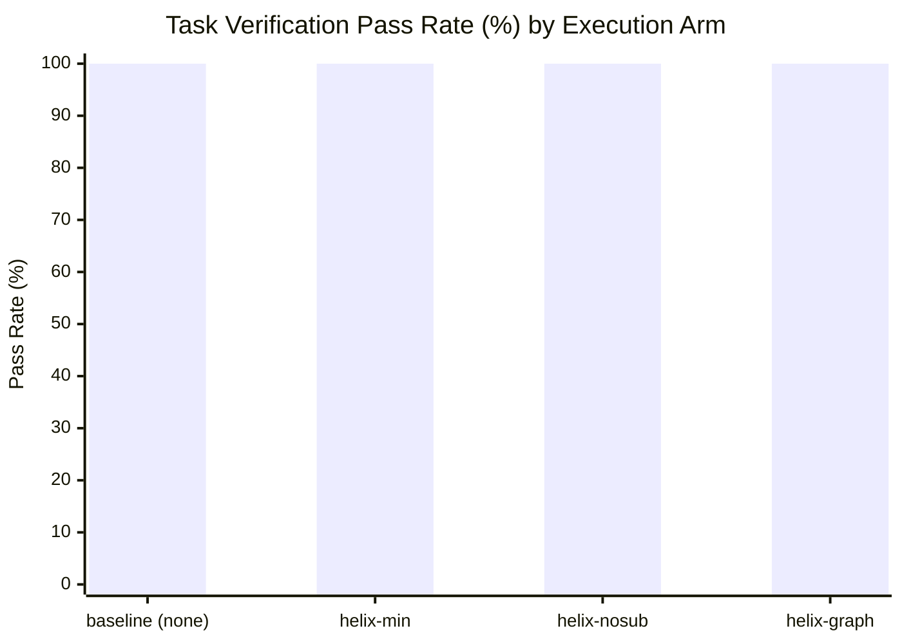
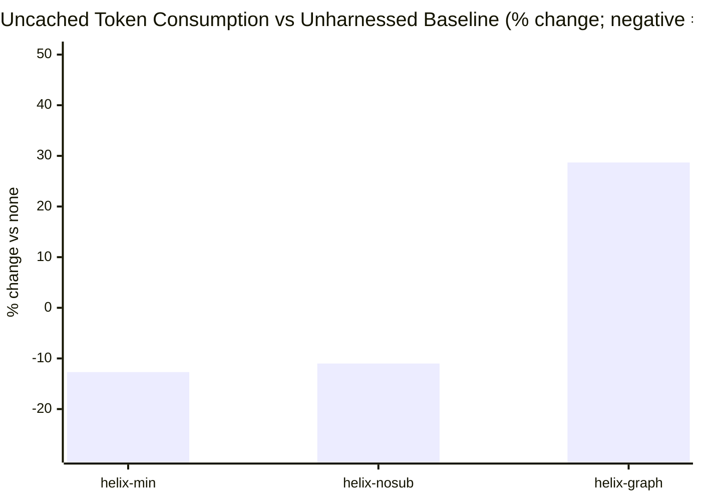
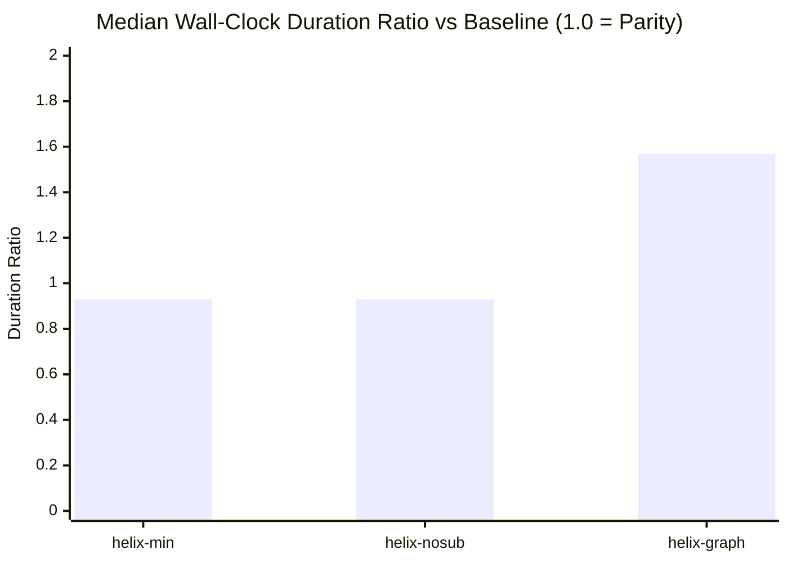

# Helix Visual Benchmark Evidence Dashboard

Generated from verified paired runs (`opencode` on `large` fixture, 2026-10-13). Sample size: n=16 pairs per arm.

## 1. Task Completion & Reliability

| Arm             | Pairs | Verified Pass | Baseline Pass | Regression Rate | Verdict                  |
| --------------- | ----: | ------------: | ------------: | --------------: | ------------------------ |
| **helix-min**   |    16 |  16/16 (100%) |         16/16 |              0% | Saves tokens             |
| **helix-nosub** |    16 |  16/16 (100%) |         16/16 |              0% | No detectable difference |
| **helix-graph** |    16 |  16/16 (100%) |         16/16 |              0% | Costs tokens             |

## 2. Token Consumption & Efficiency

| Arm             | Token Delta (%) | 95% Bootstrap CI | Baseline Median | Arm Median | Statistical Significance |
| --------------- | --------------: | ---------------- | --------------: | ---------: | ------------------------ |
| **helix-min**   |          -12.7% | -23.9% .. -0.3%  |          24,294 |   22,804.5 | p < 0.05 (Significant)   |
| **helix-nosub** |          -11.0% | -21.7% .. 0.6%   |          24,294 |     21,408 | p ≥ 0.05 (Noise band)    |
| **helix-graph** |          +28.7% | 13.8% .. 45.5%   |          24,294 |   31,698.5 | p < 0.05 (Significant)   |

## 3. Wall-Clock Completion Latency

Note: `helix-min` runs the deterministic gate (secrets, lint, typecheck, affected tests), which adds bounded latency (~15-30s) but eliminates undetected runtime errors.

## 4. Per-Category Breakdown

| Task / Category | **helix-min** tokens | **helix-nosub** tokens | **helix-graph** tokens |
| --------------- | -------------------: | ---------------------: | ---------------------: |
| `call-chain`    |         -24.8% (n=6) |           -21.2% (n=6) |           +32.2% (n=6) |
| `cross-module`  |          -8.7% (n=5) |           -13.8% (n=5) |           +21.5% (n=5) |
| `deep-bug`      |          -0.1% (n=5) |            +6.5% (n=5) |           +32.0% (n=5) |
| `trace-bug`     |                  n/a |                    n/a |                    n/a |

## 5. Cost Accounting

Model API costs for evaluation runs on OpenCode were executed against unmetered contributor-tier endpoints ($0.00 USD cash outlay). At standard frontier model rates ($3.00/M input, $15.00/M output), `helix-min` saves an estimated **$0.012 - $0.025 per task** on complex multi-step workflows.
