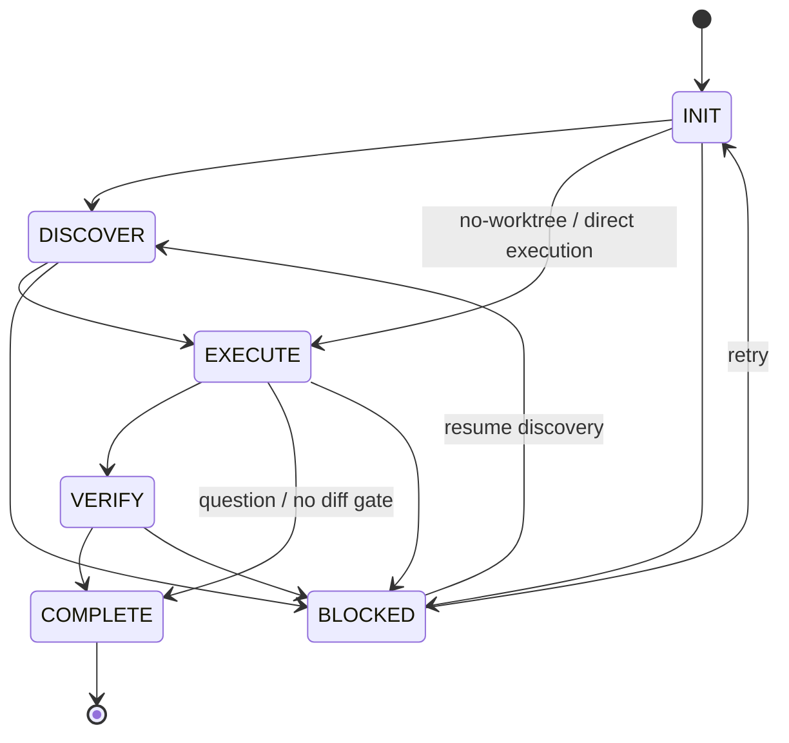
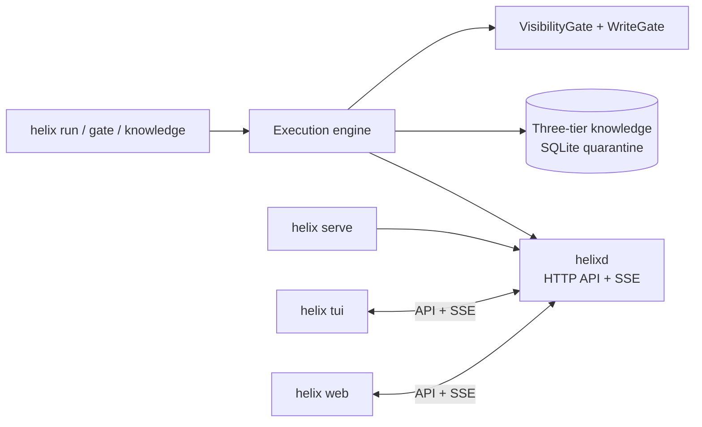

# Helix v2 architecture

Helix combines a deterministic instruction-pack generator with a coding-task execution engine. The engine progressively reveals context, controls tool visibility and writes, and coordinates optional scout, audit, and peer-team topologies. The CLI, Terminal UI, and Web UI connect to the same `helixd` daemon.

## Five-stage workflow

`INIT` normalizes the task and resolves configuration. `DISCOVER` selects relevant domains, tools, and execution mode. `EXECUTE` runs the master loop or a bounded topology. `VERIFY` applies deterministic checks and, when selected, a context-firewalled second-model audit. `COMPLETE` records the result and final diff. Direct runs can skip discovery; question runs can complete without a diff gate; blocked work can retry from initialization or discovery.

## Progressive Disclosure Master Loop

The master loop starts with a measured bootstrap prompt under 600 tokens and a Tier 0 route catalog under 250 tokens. It uses `load_skill` to load one canonical domain skill and `tool_search` to locate additional tools on demand. The **VisibilityGate** filters available tools by task and phase. The **WriteGate** enforces workspace boundaries, peer ownership, and required plan approval before writes.

At a configured 92% context-use threshold, old tool output is written to `.helix/runtime/<session>/NOTES.md` and replaced in the active context with digest pointers. The 92% value is the trigger threshold. It is not a compression ratio. Static-cost evidence compares the bootstrap with the smallest measured static pack and records method/date in [EVIDENCE.md](EVIDENCE.md).

## Three-tier knowledge

| Tier                        | Data and behavior                                                                                                                                                                                                                           |
| --------------------------- | ------------------------------------------------------------------------------------------------------------------------------------------------------------------------------------------------------------------------------------------- |
| **0 — Routing**             | `src/knowledge/discovery.ts` compiles `.helix/knowledge/domains/*/domain.md` frontmatter (`id`, `description`, `paths`) into a deterministic compact catalog. Supported path aliases are accepted for existing domain packs.                |
| **1 — Canonical**           | Read-only `SKILL.md` or `domain.md` content, capped at 600 tokens, `references/*.md`, and zero-token executable AST verification in `scripts/*.mjs`.                                                                                        |
| **2 — Episodic quarantine** | Mutable `.helix/knowledge/helix-memory.db`: `better-sqlite3` in WAL mode, FTS5 search, and `sqlite-vec` `vec0` with 384-dimensional cosine KNN. Full-text and vector results are fused with RRF; structural matching uses `@ast-grep/napi`. |

Tier 2 records remain quarantined until reviewed and compacted offline with `helix knowledge compact`. Vector features currently use deterministic trigram hashing rather than a learned embedding service.

## Execution topologies

- **`MODE_1_MASTER_LOOP`**: bounded single-threaded execution; default for routine work. About 80% is the intended task share, not an observed measurement.
- **`MODE_2_DISPOSABLE_SCOUT`**: read-only `Read`, `Grep`, `Glob`, and `ast_search`; maximum 8 turns and 250-token JSON synthesis.
- **`MODE_3_ADVERSARIAL_AUDITOR`**: Stage A runs deterministic checks. On pass, Stage B routes a firewalled diff and task context to a different model family. Claude generation routes to a Codex-family auditor; other generators route to Claude when available.
- **`MODE_4_PEER_TEAM`**: a file-locked shared DAG at `.helix/runtime/teams/{id}/tasks.json`; NFA-based wildcard overlap checks enforce `ownedPaths`. Plans pass through `approve_teammate_plan`; sanitized P2P messages are stored in `inboxes/`; peers can be consulted mid-loop or used for hypothesis exploration.

## Daemon and clients

`helix serve` starts `helixd`, which owns task/session state and streams updates over Server-Sent Events (SSE). `helix tui` and `helix web` connect to the same daemon and therefore share live sessions and state. Each client can start or attach to the daemon according to its CLI options. The web client is built as part of `npm run build`.

## Provider configuration

Provider values merge by field in this order: runtime overrides, CLI flags, environment variables, trusted workspace `.helix/config.toml`, global `~/.config/helix/providers.toml`, and built-in defaults. Sensitive workspace provider settings require explicit workspace trust. Local endpoint normalization strips known API suffixes; keyless loopback endpoints use the synthetic `sk-helix-local` credential. See [Configuration](CONFIGURATION.md).

## Evidence and implementation map

Token claims come from `node scripts/static-cost.mjs`; generated evidence is refreshed by `node scripts/render-evidence.mjs`. Benchmark results and limitations are documented separately; measured benchmark results should not be generalized beyond their stated samples.

- Workflow: `src/workflow.ts`, `src/engine/`
- Knowledge: `src/knowledge/`
- Providers: `src/engine/config-loader.ts`, `src/engine/url-sanitizer.ts`, `src/engine/doctor.ts`
- Daemon and clients: `daemon/`, `tui/`, `web/`
- CLI: `cli/helix.mjs`
