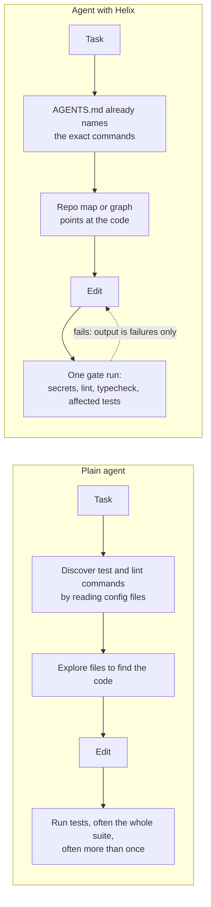
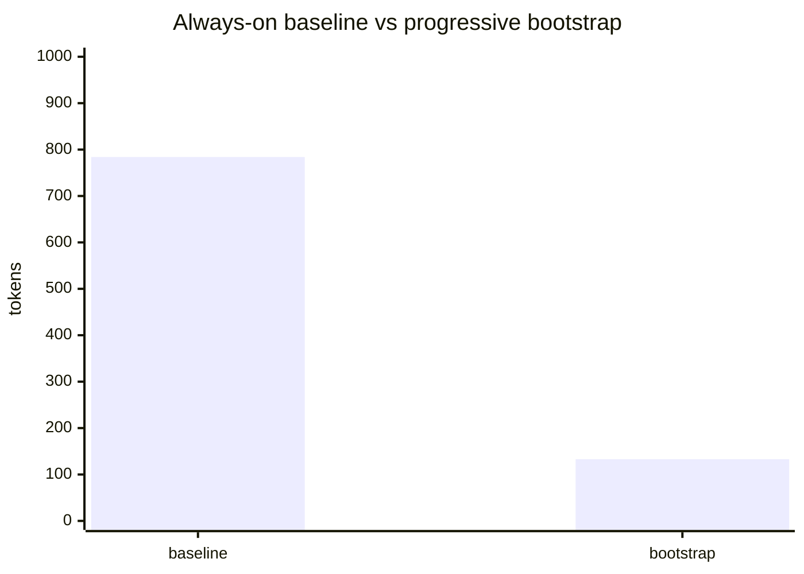
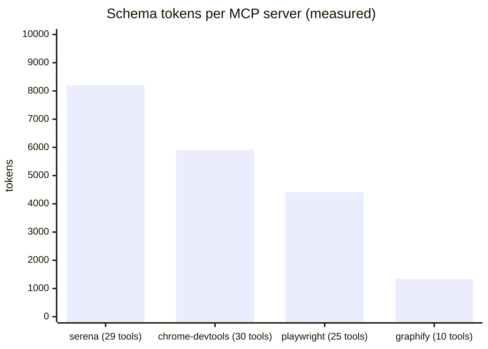
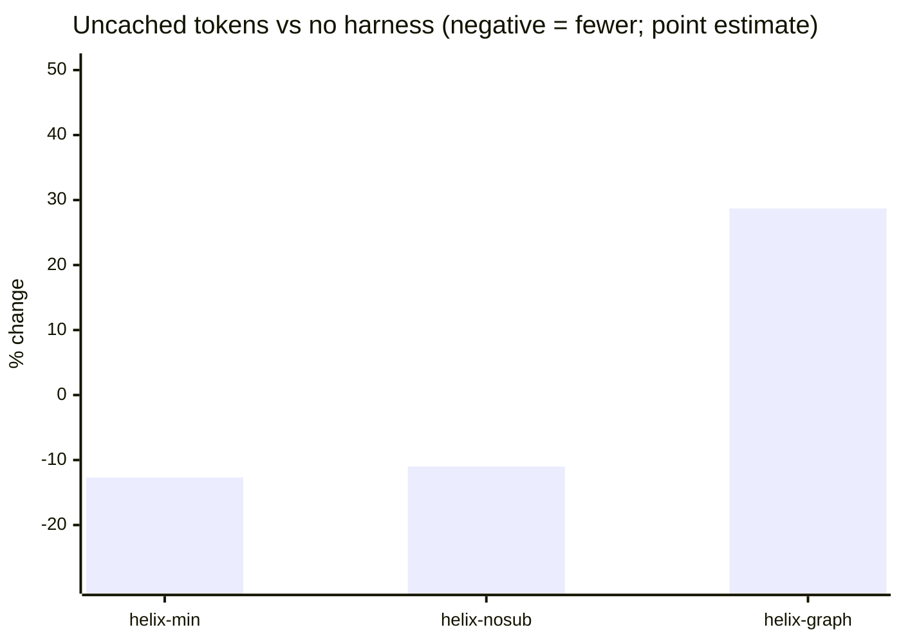

# Does Helix help? The evidence

This page is generated from committed result files. Every number sits in a block between
`evidence:*:start` and `evidence:*:end` markers and is rewritten by
`node scripts/render-evidence.mjs`; `scripts/evidence.test.mjs` fails if the page drifts from the
data. Prose outside the blocks makes no numeric claim.

## What Helix changes, and what it claims



The claim being tested is narrow: **the same agent, on the same tasks, solves them as often while
using fewer tokens.** Helix is not claimed to make a model smarter. The two blocks below separate
what Helix adds to every request (its cost, measured without an agent) from what it saves per task
(measured with paired agent runs).

## Static cost: what Helix adds to every request

<!-- evidence:static:start -->
### Always-on tokens Helix adds, by repo shape

What an agent carries on every request: `AGENTS.md`, skill index, MCP schemas (and the crew index with `--crew`). A plain agent adds 0, so this is Helix's **cost**.

```mermaid
xychart-beta
    title "Helix always-on tokens (default pack vs --crew)"
    x-axis ["small repo", "large repo", "large UI repo"]
    y-axis "tokens" 0 --> 9000
    bar [784, 2123, 6539]
    bar [1203, 2591, 7007]
```



| Repo shape | AGENTS.md | skill index | MCP schemas | crew index (`--crew`) | always-on | with `--crew` |
| --- | ---: | ---: | ---: | ---: | ---: | ---: |
| small repo | 290 | 74 | 420 | 237 | 784 | 1203 |
| large repo | 293 | 74 | 1756 | 286 | 2123 | 2591 |
| large UI repo | 296 | 74 | 6169 | 286 | 6539 | 7007 |

MCP schema weights are measured from live `tools/list` captures except context7 (catalog estimate, unmeasured). On Claude Code the schemas are deferred by tool search (verified 2026-10-10), so the MCP column does not load there by default; other platforms are assumed to load it.

### Progressive disclosure bootstrap

The always-on bootstrap is **133 tokens**, including a **79-token Tier 0 route catalog**. Compared with the smallest current always-on pack scenario (**784 tokens**), that is an **83% reduction**. The bootstrap stays below 600 tokens, Tier 0 below 250 tokens, and the reduction above 80%.
Measured 2026-11-07 using o200k_base BPE via gpt-tokenizer (approximation of frontier tokenizers, not the serving model's own count).



### What unmanaged MCP loading would cost

Real captured schemas, loaded every request with no curation: **19867 tokens** for four servers. Helix ships at most five and defaults to one or two.



### Zero-token checks

The gate (secrets, lint, typecheck, affected tests) and the hooks are deterministic scripts: **0 model tokens**. src/gate.ts is a deterministic script (secrets, lint, typecheck, tests).

Method: o200k_base BPE via gpt-tokenizer (approximation of frontier tokenizers, not the serving model's own count). Source: `evals/results/static-cost.json`.
<!-- evidence:static:end -->

## Measured: Helix against the same agent with no harness

<!-- evidence:paired:start -->
Paired runs, opencode, large fixture, 2026-10-13. Each task and run index executes in every arm back to back; the baseline is the same agent with no pack.



| Arm | Pairs | Uncached tokens vs none | 95% CI | Passed (arm / none) | Passes lost / gained | Verdict |
| --- | ---: | ---: | --- | ---: | ---: | --- |
| helix-min | 16 | -12.7% | -23.9% .. -0.3% | 16/16 vs 16/16 | 0 / 0 | saves tokens |
| helix-nosub | 16 | -11.0% | -21.7% .. +0.6% | 16/16 vs 16/16 | 0 / 0 | no detectable difference |
| helix-graph | 16 | +28.7% | +13.8% .. +45.5% | 16/16 vs 16/16 | 0 / 0 | costs tokens |

Per task (point estimate and 95% CI; each task has few pairs, so read these as direction, not proof):

| Task | helix-min | helix-nosub | helix-graph |
| --- | --- | --- | --- |
| call-chain | -24.8% (-37.3% .. -9.0%), n=6 | -21.2% (-37.7% .. -1.6%), n=6 | +32.2% (+7.4% .. +61.1%), n=6 |
| cross-module | -8.7% (-31.6% .. +21.9%), n=5 | -13.8% (-25.4% .. -1.2%), n=5 | +21.5% (-5.0% .. +61.6%), n=5 |
| deep-bug | -0.1% (-10.5% .. +11.6%), n=5 | +6.5% (-7.7% .. +27.0%), n=5 | +32.0% (+15.7% .. +49.9%), n=5 |
| trace-bug | n/a (n/a .. n/a), n=0 | n/a (n/a .. n/a), n=0 | n/a (n/a .. n/a), n=0 |

Method: uncached tokens (input + output + reasoning + cache writes, cache reads excluded) from the agent's own session transcript; paired log-ratio bootstrap (10,000 resamples, seed 1) for the interval; exact sign test on discordant pass/fail pairs. Pairs where either side hit a provider rate limit or hung with zero tokens are dropped. A verdict of "no detectable difference" means the interval includes zero, not that the arms are equal.
<!-- evidence:paired:end -->

## How to reproduce

```sh
node evals/run.mjs --agent opencode --opencode-model <free-model> \
  --arms none,helix-min,helix-nosub,helix-graph --runs 6 --fixture large
node scripts/paired-stats.mjs evals/results/<stamp>-opencode.json --out evals/results/paired-stats.json
node scripts/render-evidence.mjs
```

The runner interleaves arms per task and run so provider load hits every arm alike, drops
rate-limited pairs, retries zero-token hangs once, and records each cell as it finishes.
