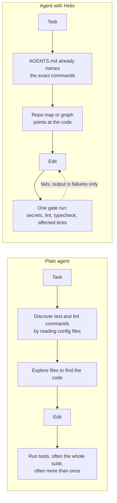
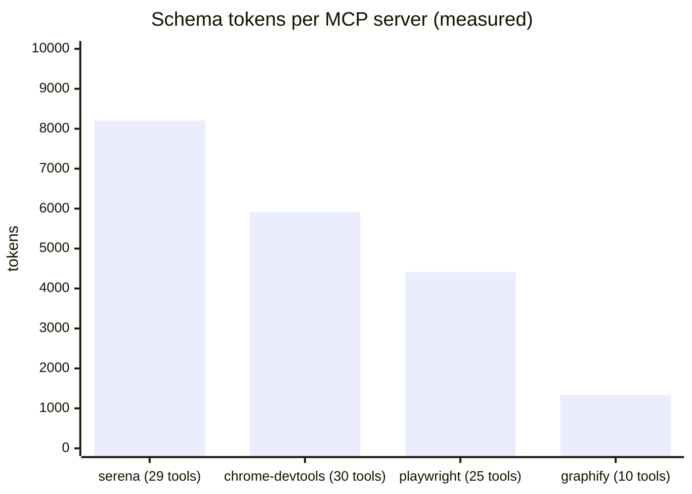

# Does Helix help? The evidence

This page is generated from committed result files. Every number sits in a block between
`evidence:*:start` and `evidence:*:end` markers and is rewritten by
`node scripts/render-evidence.mjs`; `scripts/evidence.test.mjs` fails if the page drifts from the
data. Prose outside the blocks makes no numeric claim.

## What Helix changes, and what it claims



The claim being tested is narrow: **the same agent, on the same tasks, solves them as often while
using fewer tokens.** Helix is not claimed to make a model smarter. The two blocks below separate
what Helix adds to every request (its cost, measured without an agent) from what it saves per task
(measured with paired agent runs).

## Static cost: what Helix adds to every request

<!-- evidence:static:start -->
### Always-on tokens Helix adds, by repo shape

What an agent carries on every request: `AGENTS.md`, skill index, MCP schemas (and the crew index with `--crew`). A plain agent adds 0, so this is Helix's **cost**.

```mermaid
xychart-beta
    title "Helix always-on tokens (default pack vs --crew)"
    x-axis ["small repo", "large repo", "large UI repo"]
    y-axis "tokens" 0 --> 9000
    bar [784, 2123, 6539]
    bar [1203, 2591, 7007]
```



| Repo shape | AGENTS.md | skill index | MCP schemas | crew index (`--crew`) | always-on | with `--crew` |
| --- | ---: | ---: | ---: | ---: | ---: | ---: |
| small repo | 290 | 74 | 420 | 237 | 784 | 1203 |
| large repo | 293 | 74 | 1756 | 286 | 2123 | 2591 |
| large UI repo | 296 | 74 | 6169 | 286 | 6539 | 7007 |

MCP schema weights are measured from live `tools/list` captures except context7 (catalog estimate, unmeasured). On Claude Code the schemas are deferred by tool search (verified 2026-10-10), so the MCP column does not load there by default; other platforms are assumed to load it.

### What unmanaged MCP loading would cost

Real captured schemas, loaded every request with no curation: **19867 tokens** for four servers. Helix ships at most five and defaults to one or two.



### Zero-token checks

The gate (secrets, lint, typecheck, affected tests) and the hooks are deterministic scripts: **0 model tokens**. src/gate.ts is a deterministic script (secrets, lint, typecheck, tests).

Method: o200k_base BPE via gpt-tokenizer (approximation of frontier tokenizers, not the serving model's own count). Source: `evals/results/static-cost.json`.
<!-- evidence:static:end -->

## Measured: Helix against the same agent with no harness

<!-- evidence:paired:start -->
No paired run has been recorded yet.
<!-- evidence:paired:end -->

## How to reproduce

```sh
node evals/run.mjs --agent opencode --opencode-model <free-model> \
  --arms none,helix-min,helix-nosub,helix-graph --runs 6 --fixture large
node scripts/paired-stats.mjs evals/results/<stamp>-opencode.json --out evals/results/paired-stats.json
node scripts/render-evidence.mjs
```

The runner interleaves arms per task and run so provider load hits every arm alike, drops
rate-limited pairs, retries zero-token hangs once, and records each cell as it finishes.
