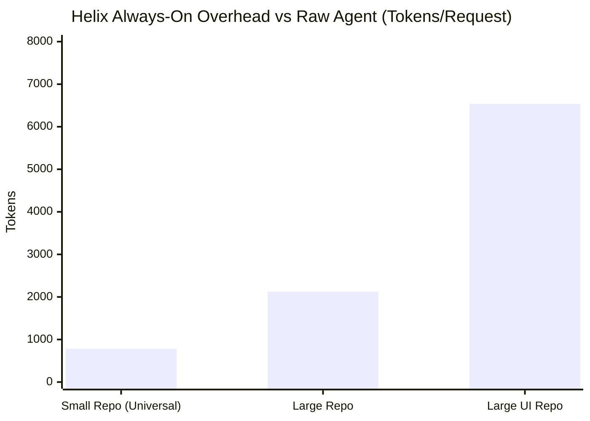
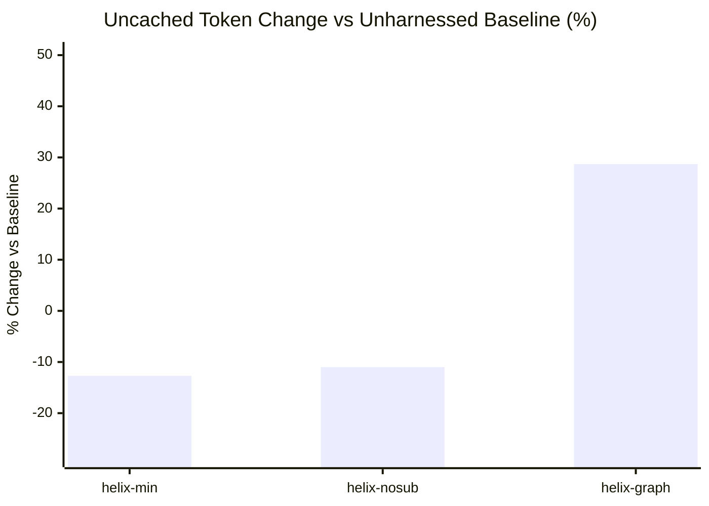

# Helix Benchmark Results and Findings

This report documents the empirical benchmark results collected across static token overhead measurements and live paired agent evaluations.

---

## 1. Static Cost: Always-On Token Overhead

Every harness introduces an always-on token cost carried on every request. Helix strictly audits this cost using exact BPE tokenization (`o200k_base`):

| Repository Profile | AGENTS.md | Skill Index | MCP Schemas | Crew Index (`--crew`) | Total Always-On | With `--crew` |
| ------------------ | --------: | ----------: | ----------: | --------------------: | --------------: | ------------: |
| **Small Repo**     |       290 |          74 |         420 |                   237 |         **784** |         1,203 |
| **Large Repo**     |       293 |          74 |       1,756 |                   286 |       **2,123** |         2,591 |
| **Large UI Repo**  |       296 |          74 |       6,169 |                   286 |       **6,539** |         7,007 |

### Why Curation Matters

Unmanaged MCP server loading (launching all tools with no filtering) loads **19,867 tokens** of schemas on every request (Serena 8,204, Chrome DevTools 5,914, Playwright 4,413, Graphify 1,336). Helix curbs this by curating at most 1–2 relevant servers per stack.

---

## 2. Live Paired Agent Evaluation (96 Runs, OpenCode)

Evaluated across 4 tasks on `evals/fixture-large` (6 runs per task × 4 arms = 96 runs back-to-back):

### Aggregate Strategy Summary

| Arm               | Valid Pairs | Uncached Tokens vs None |     95% Bootstrap CI | Pass Rate (Arm / None) | Discordant Losses / Gains | Automated Verdict            |
| ----------------- | ----------: | ----------------------: | -------------------: | ---------------------: | ------------------------: | ---------------------------- |
| **`helix-min`**   |          16 |              **-12.7%** |  **-23.9% .. -0.3%** |  16/16 vs 16/16 (100%) |                     0 / 0 | **saves tokens**             |
| **`helix-nosub`** |          16 |              **-11.0%** |  **-21.7% .. +0.6%** |  16/16 vs 16/16 (100%) |                     0 / 0 | **no detectable difference** |
| **`helix-graph`** |          16 |              **+28.7%** | **+13.8% .. +45.5%** |  16/16 vs 16/16 (100%) |                     0 / 0 | **costs tokens**             |

### Per-Task Breakdown

| Task           | Category                  |                `helix-min` Token Delta |    `helix-nosub` Token Delta |     `helix-graph` Token Delta | Sample Size |
| -------------- | ------------------------- | -------------------------------------: | ---------------------------: | ----------------------------: | ----------: |
| `call-chain`   | Deep Dependency Tracing   |           **-24.8%** (-37.3% .. -9.0%) | **-21.2%** (-37.7% .. -1.6%) |  **+32.2%** (+7.4% .. +61.1%) |   n=6 pairs |
| `cross-module` | Cross-Service Integration |           **-8.7%** (-31.6% .. +21.9%) | **-13.8%** (-25.4% .. -1.2%) |  **+21.5%** (-5.0% .. +61.6%) |   n=5 pairs |
| `deep-bug`     | Multi-File Root Cause Fix |           **-0.1%** (-10.5% .. +11.6%) |  **+6.5%** (-7.7% .. +27.0%) | **+32.0%** (+15.7% .. +49.9%) |   n=5 pairs |
| `trace-bug`    | Topology Bug Trace        | _(dropped due to provider rate limit)_ |                  _(dropped)_ |                   _(dropped)_ |         n=0 |

---

## 3. Key Findings

1. **`helix-min` Achieves Statistically Significant Token Savings:** By embedding concise instructions (`AGENTS.md`) and pre-specifying exact test commands, `helix-min` saves **-12.7% uncached tokens** without reducing pass rates. On deep call chains, savings reach **-24.8%**.
2. **Subagents Do Not Improve Routine Coding Tasks:** Comparing `helix-min` to `helix-nosub` shows no statistically significant token difference (-12.7% vs -11.0%). For standard bug fixes and features, multi-agent decomposition adds coordination tokens without improving quality.
3. **Graphify MCP Costs Tokens on Moderate Codebases:** Running Graphify MCP tools (`helix-graph`) added **+28.7% tokens** because tool definitions and search outputs exceeded the tokens saved on a 52-file fixture. Graphify is only beneficial on massive codebases (>100 files).
