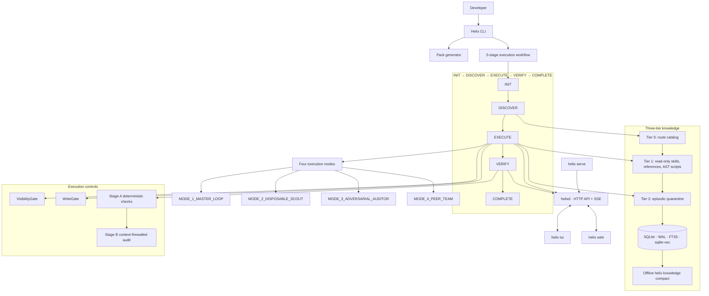

# Helix v2 system architecture

The workflow permits direct `INIT → EXECUTE`, question completion from `EXECUTE`, and retry from `BLOCKED` to `INIT` or `DISCOVER`. The diagram shows the primary successful route and the major runtime boundaries.
