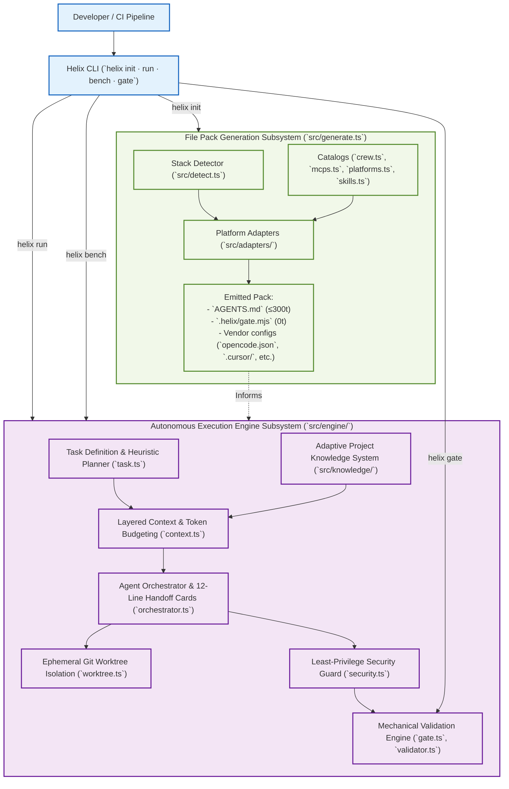
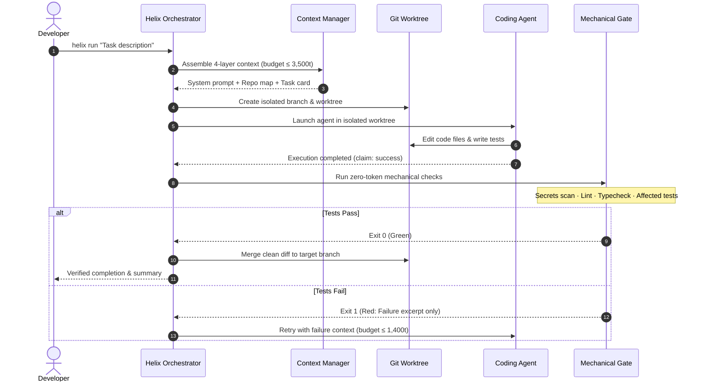

# Helix Architecture Diagrams

This document contains visual diagrams depicting Helix's dual-modality architecture, subsystem boundaries, and component interaction topology.

---

## 1. Dual-Modality System Overview

Helix operates across two complementary operating modes:

1. **File Pack Generation**: Inspects an existing repository and emits minimal, platform-tailored configuration packs (`AGENTS.md` ≤ 300 tokens, `.helix/`, skills, MCPs).
2. **Autonomous Execution Engine**: Drives coding agents with progressive context assembly, worktree isolation, security bounds, and zero-token mechanical gates.

---

## 2. Component Interaction & Security Boundary

