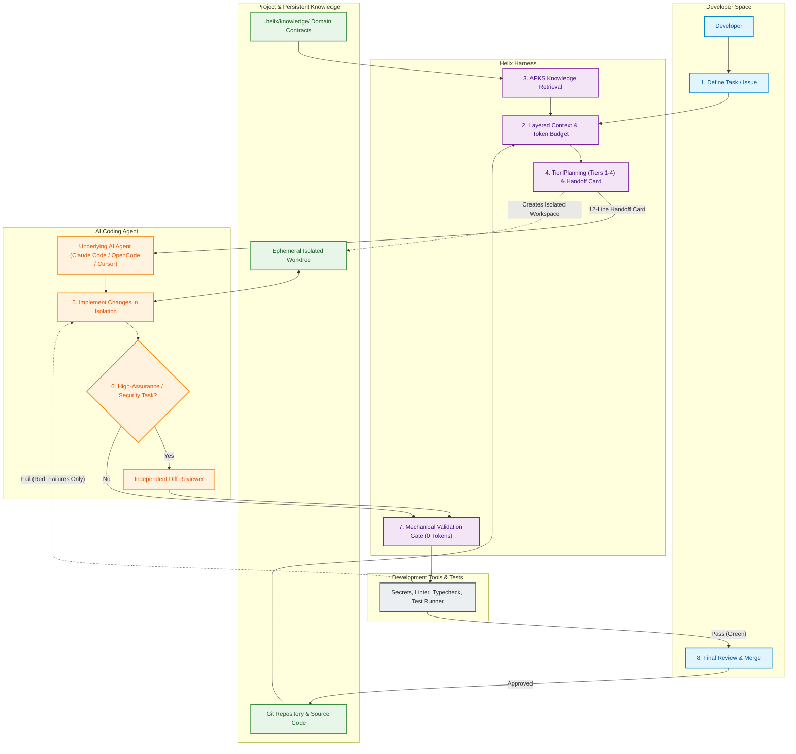

# Helix Development Workflow Diagram

This document illustrates the end-to-end development workflow when using Helix, showing how a developer interacts with Helix, how Helix guides the underlying AI coding agent, and how validation gates enforce software quality.

---

## The Helix Developer Journey

---

## Workflow Stages Explained

1. **Task Definition:** The developer starts with an existing codebase and assigns a task (e.g. bug fix, feature, refactoring).
2. **Context Assembly:** Helix inspects the project, selects relevant files without loading the whole repo, and enforces strict token budgets.
3. **Knowledge Retrieval:** The Adaptive Project Knowledge System (APKS) injects domain contracts and naming rules in under 15ms.
4. **Task Planning:** Helix classifies the work into Tiers 1–4. Simple tasks stay single-agent; complex tasks receive a concise 12-line handoff card.
5. **Execution in Isolation:** The coding agent executes changes inside an ephemeral Git worktree, leaving the developer's working tree clean.
6. **Optional Reviewer:** For security-sensitive or high-risk tasks, an independent reviewer agent audits only the diff.
7. **Zero-Token Gate:** Helix mechanically verifies secrets, lint, types, and affected tests using 0 model tokens.
8. **Developer Review:** The developer inspects a verified, clean diff with high confidence and merges.
