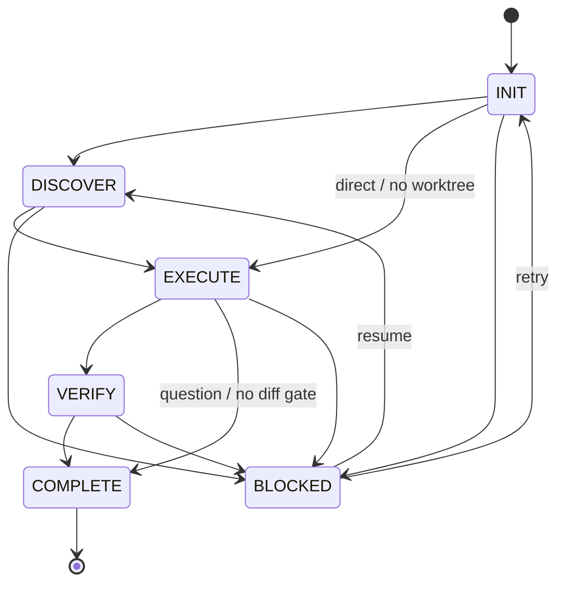
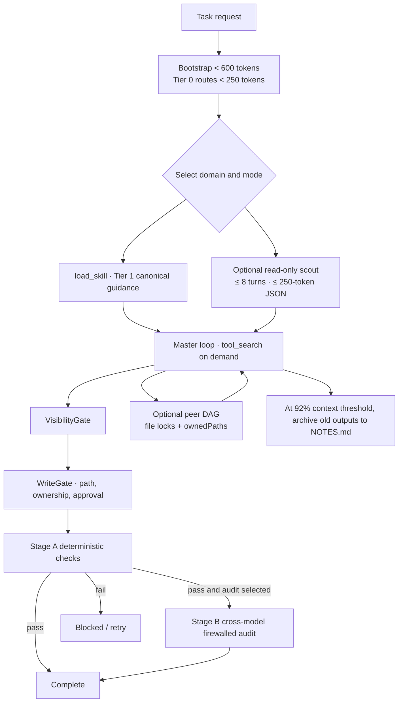

# Helix v2 development workflow

## Stage responsibilities

1. **INIT:** normalize the task, resolve provider configuration, and select workspace/runtime state.
2. **DISCOVER:** match Tier 0 domain routes, then load only selected Tier 1 skills and tools.
3. **EXECUTE:** run the master loop; bounded scouts and peer teams are optional topologies.
4. **VERIFY:** run deterministic gates first. A selected second-model audit runs only after Stage A passes and receives a context-firewalled summary.
5. **COMPLETE:** persist the final outcome and expose it to the CLI and daemon clients.

Tier 2 episodic records are retrieved as quarantined hints. `helix knowledge compact` reviews and maintains them offline; the runtime does not silently promote them to canonical rules.
